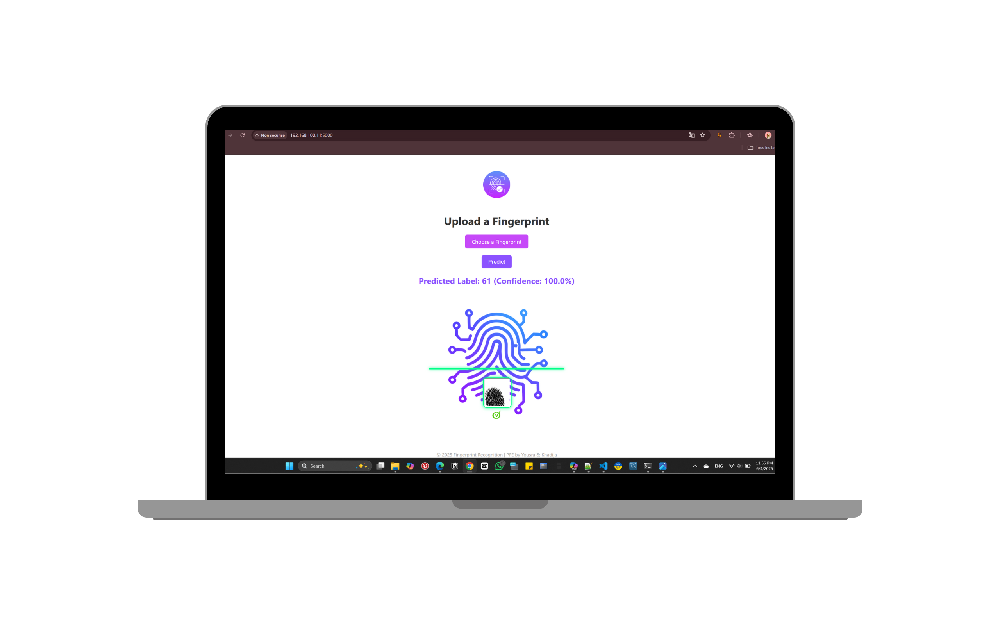

# 🧠 Fingerprint Recognition using Deep Learning and Flask

This is my final year project for fingerprint recognition using Convolutional Neural Networks (CNN).

The original application is developed using Python, TensorFlow/Keras, OpenCV and Flask. It allows users to upload fingerprint images and predict the corresponding user ID.

## 🌐 Live Demo

Try the online fingerprint recognition application:

👉 **[Open Fingerprint Recognition Demo](https://youcy-fingerprint-recognition-demo.static.hf.space?utm_source=chatgpt.com)**

**Note:** The online demo is a separate browser-based version powered by TensorFlow.js. The original application remains based on Flask and TensorFlow/Keras.

## 📁 Project Structure

```text
fingerprint_model/
├── app/
│   ├── app.py
│   ├── utils.py
│   ├── static/
│   │   └── (icons, CSS, uploads...)
│   ├── templates/
│   │   └── (HTML frontend)
│   └── model/
│       └── (trained model and encoder)
├── training/
│   └── notebook.ipynb
├── requirements.txt
└── README.md
```

## 🔧 Features

- CNN model trained on the SOCOFing dataset
- Flask web interface to upload fingerprint images
- Prediction of user ID from fingerprint images
- Custom user interface with scanning animation
- Success and error feedback using icons and sounds
- Online browser-based demo using TensorFlow.js

## 🛠️ Tech Stack

- Python
- TensorFlow / Keras
- Convolutional Neural Networks (CNN)
- OpenCV
- Flask
- TensorFlow.js (online demo)
- HTML / CSS
- JavaScript

## 🚀 Installation

Clone the repository:

```bash
git clone https://github.com/youcy03/fingerprint_model.git
```

Install the dependencies:

```bash
pip install -r requirements.txt
```

Run the application:

```bash
cd app
python app.py
```

## 📸 Preview

### Homepage


### Prediction Result



## 👩‍💻 Author

**Bachri Yousra**

[GitHub](https://github.com/youcy03) | [Email](mailto:yousra.bachri03@gmail.com)
